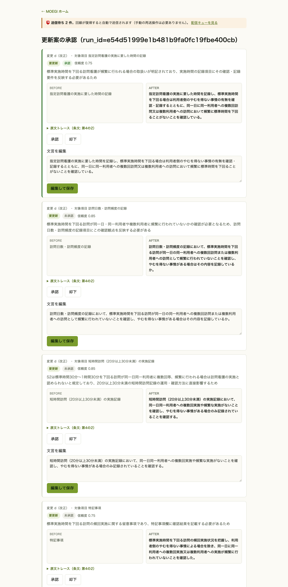
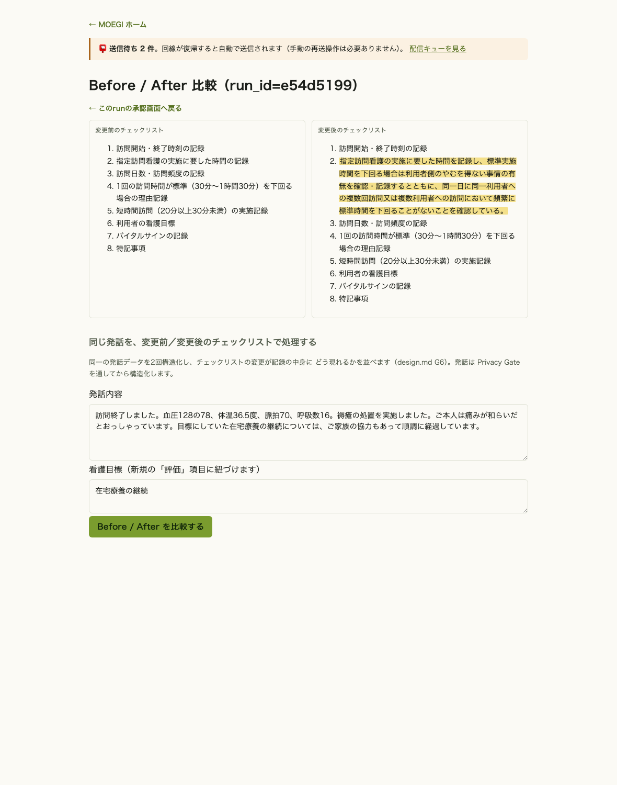
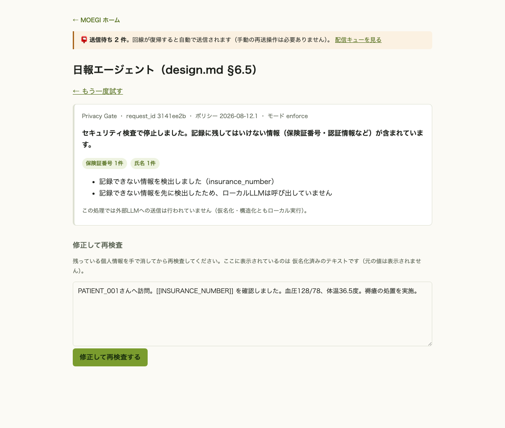
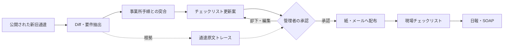
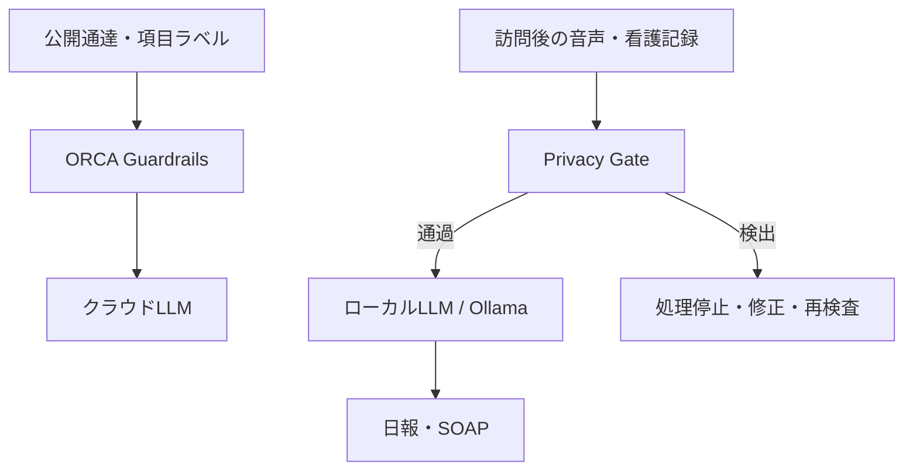

# MOEGI

> 通達Diff → チェックリスト更新 → 現場記録までを、一本の承認可能な流れにする。

MOEGIは、訪問看護事業所向けの制度改定対応プロトタイプです。
公開された新旧通達の差分を抽出し、事業所ごとのチェックリストへの影響と更新案を生成します。
管理者が承認した変更だけを紙・メールなどの既存媒体へ配布し、そのルールを日報・SOAPの記録まで反映します。

本リポジトリはハッカソン提出用のプロトタイプです。診療報酬請求、医療判断、個人情報保護の実運用を単独で保証する製品ではありません。

## デモ画面

| 通達Diff・更新案・承認 | 同じ音声によるBefore / After |
|---|---|
|  |  |

| 音声から日報・SOAP | Privacy Gateによる停止 |
|---|---|
|  |  |

画面内の事業所・利用者・職員情報は、すべて架空の合成データです。

## 解決する課題

制度改定への対応は、通達を読むだけでは終わりません。

1. 新旧通達の変更点を見つける
2. 変更が事業所のどの手順に影響するか判断する
3. チェックリストを更新し、根拠を残す
4. 承認した変更を現場へ配布する
5. 訪問後の記録へ反映する

この途中で変更が止まると、古い手順での記録、記載漏れ、確認・修正作業の増加につながります。MOEGIは、この分断を「通達から現場記録までのパイプライン」として扱います。

## 主な機能

- 公開された新旧PDFの取込・正規化と変更箇所の抽出
- 行政文書と事業所チェックリストの非構造マッピング
- チェックリスト更新案と根拠条文の同時表示
- 管理者による承認・却下・編集
- 承認済み変更のFAX様式PDF、メール配布キュー
- 音声から日報・SOAPを同時生成
- 改定前後のチェックリストによるBefore / After比較
- 日報からの月報集計
- Privacy GateとORCA Guardrailsによる二層防御

## 全体フロー



差分抽出だけでなく、行政文書の表現と事業所ごとに異なる手順の間を対応付ける工程にLLMを使用しています。最終的な変更判断は人が承認します。

## セキュリティとプライバシー

MOEGIは、扱う情報によってAIの実行経路を分離しています。



- **第一防衛線 — Privacy Gate**  
  ルール、辞書、ローカルLLM、独立再検査を順に通し、`passed` 以外では構造化処理を呼びません。
- **第二防衛線 — ORCA Guardrails**  
  クラウド境界で識別子をmaskまたはblockし、遮断結果も監査記録へ残します。
- **ローカル固定**  
  患者の医療・看護情報を扱う日報、SOAP、仮名化補完はOllama上のローカルLLMで処理します。
- **暗号化保管**  
  仮名対応表はAES-256-GCMで暗号化して保存します。

直接識別子を仮名化しています。病状や服薬は残るので、取り扱いは従来どおり厳重です。

詳細は [privacy.md](design/moegi/privacy.md) を参照してください。

## データ方針

- 実在する患者、職員、事業所のデータは使用していません
- 厚生労働省の公開資料と公開標準様式を入力資料として使用します
- 事業所データは公開テンプレートを基に作成した架空の合成データです
- 実クライアントデータ、APIキー、ローカルDB、証明書はGitへ含めません

## 技術構成

- Python 3.11+
- FastAPI / Uvicorn
- SQLite
- pdfplumber / WeasyPrint
- faster-whisper
- Ollama + Gemma 4 26B
- ORCA Router / ORCA Guardrails
- pytest

## セットアップ

### 1. Python環境

```bash
git clone https://github.com/toshi-naka-boop/MOEGI.git
cd MOEGI
python3.11 -m venv .venv
source .venv/bin/activate
pip install -e ".[dev]"
```

### 2. ローカルLLM

Ollamaをインストールし、Gemma 4 26Bを用意します。

```bash
ollama pull gemma4:26b
```

Ollamaの既定接続先は `http://localhost:11434` です。別の接続先を使う場合は `OLLAMA_BASE_URL` を設定してください。

### 3. クラウド経路

通達Diffパイプラインのクラウド経路を使う場合は、ORCA RouterのAPIキーが必要です。

macOSでは、シェル履歴にキーを残さずキーチェーンへ登録できます。

```bash
security add-generic-password -a "$USER" -s orca-api -w
```

macOS以外では、起動プロセスへ `ORCA_API_KEY` と、必要に応じて `ORCA_BASE_URL` を環境変数で渡してください。`.env` ファイルは読み込みません。

### 4. 起動

```bash
export MOEGI_PRIVACY_MODE=enforce
./scripts/serve.sh
```

ブラウザで [http://localhost:8420](http://localhost:8420) を開きます。

同一ネットワーク内の端末から確認する場合、起動時に表示されるURLを使用してください。モバイルブラウザのマイク入力にはHTTPSまたはlocalhost相当のsecure contextが必要です。

## テスト

```bash
.venv/bin/python -m pytest -q
```

現在の確認結果:

```text
340 passed, 101 subtests passed
```

## ディレクトリ

```text
src/moegi/          アプリケーション本体
src/moegi/privacy/ Privacy Gate・仮名化・暗号化保管
tests/              テスト
config/             モデル・安全設定のサンプル
scripts/            起動・評価・Guardrails設定スクリプト
design/moegi/       詳細設計・セキュリティ仕様・決定履歴
eval/               開発用評価基盤
```

## 現在の制約

- ハッカソン用プロトタイプであり、本番向けの認証・ロールベース認可は未実装です
- 実運用には電子カルテや職員・利用者マスタとの正式な連携設計が必要です
- 評価値は小規模な開発用セットに基づき、一般的な精度を保証するものではありません
- 制度解釈や請求可否の最終判断は、管理者・専門職・関係機関が行う必要があります

## 設計資料

- [詳細設計](design/moegi/design.md)
- [セキュリティ・仮名化仕様](design/moegi/privacy.md)
- [設計判断と決定履歴](design/moegi/ledger.md)
- [現在の全体像](design/moegi/overview.md)

