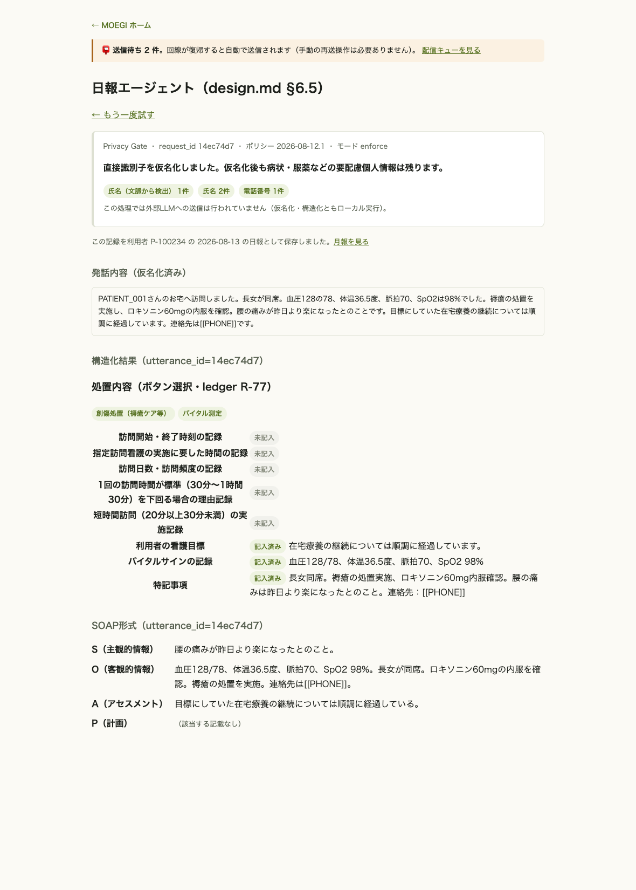
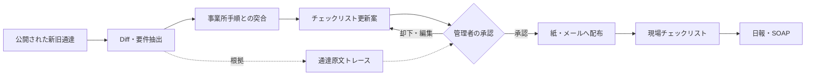
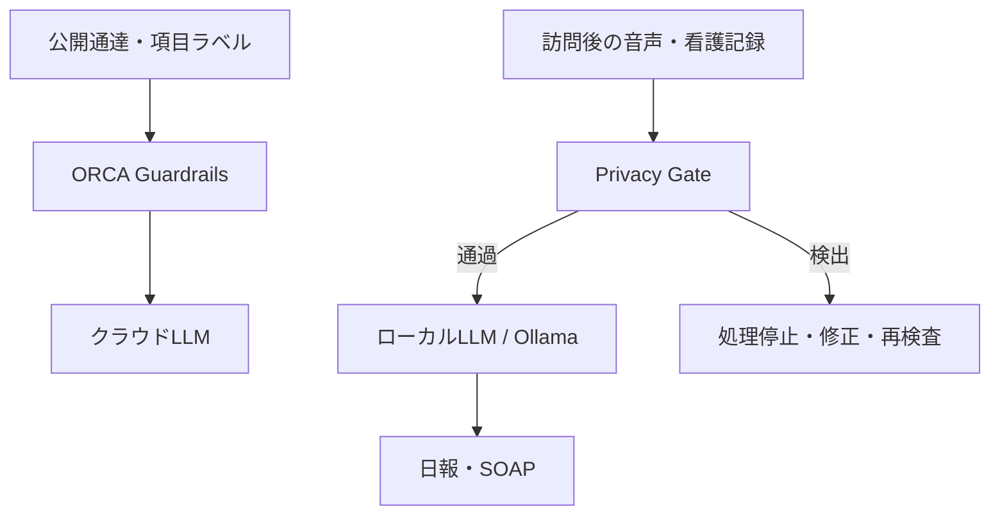

# MOEGI

> 制度改定の通達を、チェックリストの更新（管理者の承認つき）から現場の日報・月報まで届ける。

**訪問看護事業所の管理者が、制度改定の通達を読んでチェックリストを書き換える作業を、AIの更新案と承認画面で助け、承認した内容を看護師の日報入力にまで反映するためのプロトタイプです。**

公開された新旧通達の差分を抽出し、事業所ごとのチェックリストへの影響と更新案を生成します。
管理者が承認した変更は、FAX様式PDF（作成まで。印刷・送信は人が行います）とメール配信キュー（SMTP未設定ならファイル書き出し）に載り、日報・SOAPを作るときのチェックリストにも反映されます。

本リポジトリはハッカソン提出用のプロトタイプです。診療報酬請求、医療判断、個人情報保護の実運用を単独で保証する製品ではありません。

## デモ画面

| 通達Diff・更新案・承認 | 同じ音声によるBefore / After |
|---|---|
|  |  |

| 音声から日報・SOAP | Privacy Gateによる停止 |
|---|---|
|  |  |

画面内の事業所・利用者・職員情報は、すべて架空の合成データです。なお上の画像は2026年8月時点の旧い画面（`design/moegi/screenshots/README.md`）で、現在の画面とは見出しや配置が異なります。現在の画面は `scripts/demo.sh` で確かめられます。

## 解決する課題

制度改定への対応は、通達を読むだけでは終わりません。

1. 新旧通達の変更点を見つける
2. 変更が事業所のどの手順に影響するか判断する
3. チェックリストを更新し、根拠を残す
4. 承認した変更を現場へ配布する
5. 訪問後の記録へ反映する

この途中で変更が止まると、古い手順での記録、記載漏れ、確認・修正作業の増加につながります。MOEGIは、この分断を「通達から現場記録までのパイプライン」として扱います。

## 主な機能

- 新旧通達PDF（現状は保発0305第12号と第19号の1組に固定。取得は `scripts/fetch_notices.sh`）の取込・正規化と変更箇所の抽出
- 行政文書と事業所チェックリストの非構造マッピング
- チェックリスト更新案と根拠条文の同時表示
- 管理者による承認・却下・編集
- 承認・編集済み変更のFAX様式PDF、メール配布キュー（承認後に却下すると、送信待ちの通知は取り消されます。送信済みのものは取り消せません）
- 音声から日報・SOAPを同時生成（承認済みの更新案を反映したチェックリストで構造化します）
- 改定前後のチェックリストによるBefore / After比較
- 日報からの月報集計
- Privacy Gate（既定は `enforce`＝検査に通らなければ停止）と、別途設定が必要なORCA Guardrails（任意）による防御
- 動作確認用のデモモード（AIなし・合成データ。下の「まず試す」）

## 全体フロー



差分抽出だけでなく、行政文書の表現と事業所ごとに異なる手順の間を対応付ける工程にLLMを使用しています。最終的な変更判断は人が承認します。

## セキュリティとプライバシー

MOEGIは、扱う情報によってAIの実行経路を分離しています。



- **第一防衛線 — Privacy Gate**  
  ルール、辞書、ローカルLLM、独立再検査を順に通します。`enforce` モード（既定）では `passed` 以外だと構造化処理を呼びません。`observe` / `shadow` では止めずに記録だけ行います。仮名化した箇所があるのに仮名対応表を保存できないときも、画面からの利用では停止します。
- **第二防衛線 — ORCA Guardrails（任意・別途設定が必要）**  
  クラウド境界で識別子をmaskまたはblockする設計です。ORCA側のコンソールでの設定（`scripts/setup_orca_guardrail.py`。ORCAコンソールへのブラウザログインと `ORCA_CONSOLE_TOKEN` が必要）を済ませるまでは有効になりません。このリポジトリの手順だけでは有効化されません。
- **ローカル固定**  
  患者の医療・看護情報を扱う日報、SOAP、仮名化補完はOllama上のローカルLLMで処理します。
- **暗号化保管**  
  仮名対応表はAES-256-GCMで暗号化して保存します。

直接識別子を仮名化しています。病状や服薬は残るので、取り扱いは従来どおり厳重です。

詳細は [privacy.md](design/moegi/privacy.md) を参照してください。

## データ方針

- 実在する患者、職員、事業所のデータは使用していません
- 厚生労働省の公開資料と公開標準様式を入力資料として使用します
- 事業所データは公開テンプレートを基に作成した架空の合成データです
- 実クライアントデータ、APIキー、ローカルDB、証明書はGitへ含めません

## 技術構成

- Python 3.11 以上
- FastAPI / Uvicorn
- SQLite
- pdfplumber / WeasyPrint
- faster-whisper
- Ollama + Gemma 4 26B
- ORCA Router / ORCA Guardrails
- pytest / ruff

## まず試す（デモモード）

Ollama・ORCAのキー・通達PDFが無くても、画面の流れ（承認 → 配信キュー → FAX PDF → 改定前後の比較 → 日報 → 月報）を一周できます。手順はターミナルで次の3つです（macOS・Linuxで確認。Windowsは未検証）。

```bash
python3.11 -m venv .venv && source .venv/bin/activate   # Python 3.11以上が必要
pip install -e ".[dev]"
./scripts/demo.sh
```

ブラウザで [http://localhost:8420](http://localhost:8420) を開き、「分析を実行」を押します。

- **AIは動いていません。** 更新案は合成した2件（実在の通達の内容ではありません）、日報・SOAPの判定は文の単純な照合規則です。判定の質は実際のAIより大きく劣ります。画面の上部にも常に表示されます
- Privacy Gate の規則・辞書による検査と再検査は、デモでも本物のコードが動きます（ローカルAIによる補完検査だけが、何も見つけない固定の応答になります）
- 記録は `data/demo/` に作られ、本番用の `data/` とは混ざりません。やり直すときは `data/demo/` を削除してください
- 日報の入力では、利用者コードを選び、本文に「山田太郎さん」のような架空の氏名を入れると、仮名化される様子を確認できます（辞書は架空のサンプル）

実際の運用（AIによる通達分析・日報の構造化）に進むには、次の「セットアップ」が必要です。

## セットアップ

### 0. 必要なもの

- Python 3.11 以上（3.11・3.13 でテストが通ることを確認しています）
- ローカルLLM（Ollama）と `gemma4:26b`。**大きなモデルのため、必要なメモリ・GPUの条件はこのリポジトリでは検証していません。** 事前に、使うPCで `ollama run gemma4:26b` が実用的な速さで動くか確かめてください。Ollamaが動かないPCでは、日報・SOAP、Privacy Gateの補完検査は先へ進めません（安全側に停止します）
- ORCA Router のAPIキー（任意）。通達Diffでクラウドのモデルを使うためのもので、**無くても動きます**（その場合はローカルAIだけで処理するため遅くなります）。キーの発行方法は ORCA Router の提供元の案内に従ってください。このリポジトリには発行手順がありません
- コマンド（ターミナル）の操作ができる人。導入と初期設定は、情報システム担当者や外部の支援者と進めることを想定しています。Windowsでの動作は未検証です
- 起動スクリプト `scripts/serve.sh` のIPアドレス表示は macOS 向けです（Linuxでも起動はでき、IP表示は取れた場合のみ出ます）

### 1. Python環境

```bash
git clone https://github.com/toshi-naka-boop/MOEGI.git
cd MOEGI
python3.11 -m venv .venv
source .venv/bin/activate
pip install -e ".[dev]"
```

### 2. ローカルLLM

Ollama（公式サイト https://ollama.com からインストールできます）をインストールし、Gemma 4 26Bを用意します。

```bash
ollama pull gemma4:26b
```

Ollamaの既定接続先は `http://localhost:11434` です。別の接続先を使う場合は `OLLAMA_BASE_URL` を設定してください。
日報の入力前に、Ollamaが起動していることを確認してください（止まっていると、画面に日本語で案内が出て保存せずに止まります）。

### 3. クラウド経路

通達Diffパイプラインのクラウド経路を使う場合は、ORCA RouterのAPIキーが必要です。

macOSでは、シェル履歴にキーを残さずキーチェーンへ登録できます。

```bash
security add-generic-password -a "$USER" -s orca-api -w
```

ORCAのキーを使う場合、macOS以外では、起動プロセスへ `ORCA_API_KEY` と、必要に応じて `ORCA_BASE_URL` を環境変数で渡してください。`.env` ファイルは読み込みません。

### 4. 通達PDFの用意（通達Diffを動かす場合）

画面の「分析を実行」は、`data/notices/` に置いた新旧2つのPDFを読みます（`data/` はGit管理外です）。

```bash
./scripts/fetch_notices.sh
```

厚生労働省の公開PDF（取得元URLは `scripts/fetch_notices.sh` に書いてあります）を取得します。PDFの形式かどうかだけを確認し、内容が意図した通達かどうかは確認していません。取得後に目視で確かめてください。PDFが無いまま実行すると、画面に日本語で手順が表示されます。

### 5. 起動

```bash
export MOEGI_PRIVACY_MODE=enforce
./scripts/serve.sh
```

ブラウザで [http://localhost:8420](http://localhost:8420) を開きます。**既定ではこのPCだけ（127.0.0.1）で待ち受けます。**

同じネットワークの別の端末（スマホなど）から開く場合は、パスワードを決めて次のように起動します。パスワードが未設定だと、LAN公開では起動しません。

```bash
MOEGI_LAN=1 MOEGI_ACCESS_TOKEN='（自分で決めたパスワード）' ./scripts/serve.sh
```

ブラウザにパスワードの入力画面が出ます（ユーザー名は何でも構いません）。通信はHTTPのため、パスワードは暗号化されません。信頼できる閉じたネットワークの中だけで使ってください。モバイルブラウザのマイク入力にはHTTPSまたはlocalhost相当のsecure contextが必要です。

### 6. 自事業所向けの設定

- チェックリスト: `config/sitedoc_sample.toml`（サンプル）。テキストエディタで開き、`[[items]]` のまとまりごとに、`id`（変えない識別子。半角英数字とハイフン）・`label`（現場に表示する文言）・`kind`（`自由記述` など）・`required`（`true`/`false`）を書き換え・追加します。画面やスプレッドシートからの取り込みは未実装です
- 利用者・職員の辞書: `config/pseudonym_dictionary_sample.toml`（架空のサンプル。`[[patients]]` ごとに `code`・氏名・読み・敬称なしで呼ばれる姓などを書く、同じ形のTOMLファイル）。`config/privacy.toml` の `dictionary_path` で差し替え先を指定します。**実在の利用者情報を入れる場合は、リポジトリ外に置き、Gitに含めないでください**
- FAXの宛名: 環境変数 `MOEGI_SITE_NAME`（未設定なら「◯◯訪問看護ステーション」）
- 配信先メール: 環境変数 `MOEGI_DELIVERY_TO` と `MOEGI_SMTP_*`（下の表）

## 環境変数

| 名前 | 用途 | 既定 |
|---|---|---|
| `ORCA_API_KEY` / `ORCA_BASE_URL` | ORCA Router のキーと接続先。キーはコードに書かず、環境変数かmacOSキーチェーンで渡す | キーなし / `https://api.orcarouter.ai/v1` |
| `OLLAMA_BASE_URL` | ローカルLLMの接続先 | `http://localhost:11434` |
| `MOEGI_PRIVACY_MODE` | Privacy Gate のモード（`observe` / `shadow` / `enforce`）。画面からは変えられません | `config/privacy.toml`（`enforce`） |
| `MOEGI_PORT` | `serve.sh` の待ち受けポート | `8420` |
| `MOEGI_LAN` | `1` にすると同一ネットワークへ公開（`MOEGI_ACCESS_TOKEN` が必須） | 未設定（このPCだけ） |
| `MOEGI_ACCESS_TOKEN` | 設定すると全画面にパスワード（HTTP Basic）を要求する | 未設定（認証なし） |
| `MOEGI_SITE_NAME` | FAX様式の宛名に使う事業所名 | `◯◯訪問看護ステーション` |
| `MOEGI_DELIVERY_TO` | 承認通知の宛先 | `kanri@example.local` |
| `MOEGI_SMTP_HOST` / `MOEGI_SMTP_PORT` / `MOEGI_SMTP_USER` / `MOEGI_SMTP_PASSWORD` / `MOEGI_SMTP_FROM` | メール送信（SMTP）。`MOEGI_SMTP_HOST` が未設定なら `data/outbox/` へ `.eml` を書き出すだけで、実際には送られません | 未設定（ファイル書き出し） / ポート `587` |
| `MOEGI_DELIVERY_PROBE` | 回線復帰の検知に使う接続先（`host:port`）。SMTP未設定で指定もしないときは回線検査をしません | `1.1.1.1:53`（SMTP設定時のみ使用） |
| `MOEGI_DATA_DIR` | 記録（DB・FAX・メール書き出し・仮名対応表の鍵）の置き場所 | `data/` |
| `MOEGI_DEMO` | `1` でデモモード（AIなし・合成データ。通常は `scripts/demo.sh` から使う） | 未設定 |
| `MOEGI_VAULT_KEY` | 仮名対応表の暗号鍵（base64url・32バイト）。未設定だと `data/.vault_key` に自動生成され、暗号化したDBと同じ `data/` に置かれます。バックアップや持ち出しの際は、鍵とデータを分けて管理するために、この変数で鍵をデータの外に置くことを推奨します。**すでに運用を始めている場合は、既存の `data/.vault_key` の値をそのままこの変数に設定してください**（別の値にすると、過去の日報が月報で別の利用者として扱われ、既存の仮名対応表も復号できなくなります） | 未設定（`data/.vault_key`） |

## テスト

```bash
.venv/bin/python -m pytest -q
.venv/bin/ruff check src tests scripts
```

現在の確認結果（Python 3.11 と 3.13 の両方）:

```text
400 passed, 101 subtests passed
All checks passed!
```

テストはLLM・ネットワークに接続しません（LLM呼び出しは差し替えています）。実際のOllama・ORCA経由の動作はテストしていません。

## ディレクトリ

```text
src/moegi/          アプリケーション本体
src/moegi/privacy/ Privacy Gate・仮名化・暗号化保管
tests/              テスト
config/             モデル・安全設定のサンプル
scripts/            起動・評価・Guardrails設定スクリプト
design/moegi/       詳細設計・セキュリティ仕様・決定履歴
eval/               開発用評価基盤
```

## 現在の制約

- ハッカソン用プロトタイプであり、本番向けの認証・ロールベース認可は未実装です。あるのは共有パスワード（`MOEGI_ACCESS_TOKEN`）と、他サイトからの操作（CSRF）を拒むOrigin検査だけで、利用者ごとの権限や操作者の記録はありません
- 画面から分析できる通達は、新旧1組（保発0305第12号・第19号）に固定されています。別の通達を扱う画面（PDFのアップロードや対象条文の選択）は未実装です。対象条文は `config/allowlist.toml` を手で編集して決めます。CLI（`python -m moegi.cli diff`）の結果は承認画面にも保存されます
- 承認通知のメールは、SMTPを設定しない限り実際には送られず、`data/outbox/` のファイルになります。更新案の文言に識別子らしき文字列（氏名・電話番号・番号など）が見つかった場合は、承認も編集の保存も受け付けず、その旨が画面に出ます（メール・FAX・日報のチェックリストのいずれにも反映されません）。この拒否は専用の監査記録には残りません。検出は規則による検査で、すべての識別子を見つけられるとは限りません
- Privacy Gate の番号の検出（保険証・診察券など）は、「保険証番号」「保険証番号は」などのラベルの直後に番号が続く形に限られ、ラベルと番号が離れた言い方や、ラベルの無い裸の番号は見つけられません。日付は、「生まれ」「生年月日」が添えられているか、1年以上前の日付のときに生年月日として年代へ置き換えます。氏名は利用者辞書にあるものだけを規則で見つけます。選んだ利用者コードと発話中の氏名が食い違っても警告は出ません
- 配信キューの「送信済み」「回線が復帰すると送信」の表示は、SMTPを設定しない（ファイルへ書き出すだけの）場合にも出ます。その場合、実際には誰にも送られていません
- FAXは様式のPDFを作るところまでで、印刷と送信は人が行います
- 送信に失敗した通知は自動で再試行し、10回で「送信失敗」にします（その後は、更新案をいったん却下してから承認し直してください。承認済みのままでは再承認できません）。SMTPは、STARTTLSが使えるサーバーか465番ポート（SMTPS）だけに対応します
- 保存した日報は、画面で編集できません。誤った記録は月報の画面から削除し、入力し直してください。同じ利用者・訪問日で内容がまったく同じ記録は二重に保存しませんが、AIの出力が少しでも違えば別の訪問として保存されます（保存後に件数を知らせます）
- 録音はブラウザの中に一時的に置かれるだけで保存されません。ページを閉じる・再読み込みすると消えます。構造化にはサーバーとOllamaへの接続が必要です
- 新規項目の更新案を承認したあとで文言を編集すると、項目の識別子も変わり、編集前の日報とは別の項目として月報に集計されます
- デモモードは動作確認用で、AIの代わりに単純な規則を使います。実運用の判断には使えません
- 承認後に却下した場合、送信待ちの通知は取り消しますが、すでに送信済みの通知は取り消せません（画面に警告が出ます）
- 日報に使うチェックリストは、すべての分析結果から承認・編集済みの更新案を集めて反映します。同じ項目に複数の更新案がある場合は、新しい方が優先されます
- 仮名対応表の保存期間（90日）を過ぎたものは、サーバーの起動時に1回だけ削除します。起動し続けている間は削除されません
- Ollama（gemma4:26b）が必要で、動作に必要なPC性能は検証していません。`serve.sh` のIP表示などは macOS 向けです
- 音声の文字起こしは faster-whisper をローカルで使い、初回にモデルをダウンロードします。アップロードできる音声は50MBまでです
- 実運用には電子カルテや職員・利用者マスタとの正式な連携設計が必要です
- 評価値は小規模な開発用セットに基づき、一般的な精度を保証するものではありません
- 制度解釈や請求可否の最終判断は、管理者・専門職・関係機関が行う必要があります

## 設計資料

- [詳細設計](design/moegi/design.md)
- [セキュリティ・仮名化仕様](design/moegi/privacy.md)
- [設計判断と決定履歴](design/moegi/ledger.md)
- [現在の全体像](design/moegi/overview.md)

