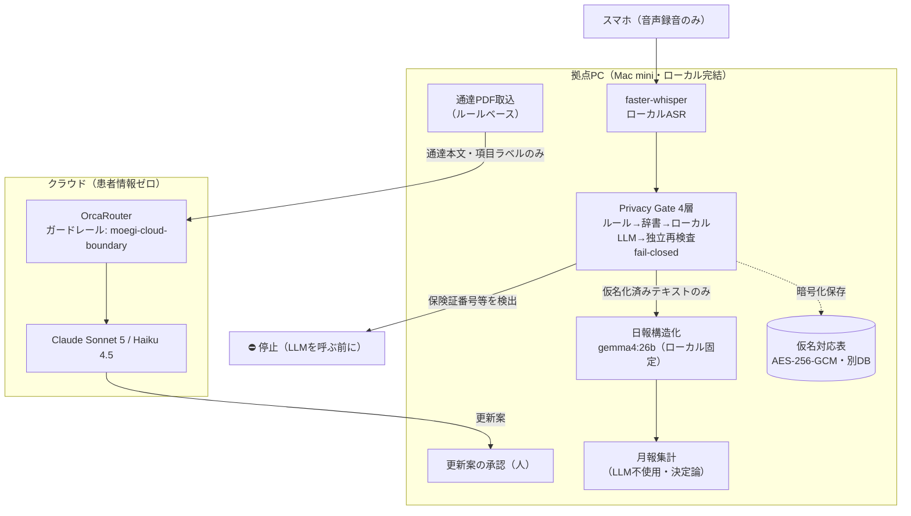

# 「クラウドにすら出さない」を設計で強制する — 訪問看護の記録AIを、ローカルLLMと多層防御で作った

<!-- Zenn公開時: topics: ["llm", "security", "ollama", "fastapi", "医療"] -->

## はじめに

訪問看護の現場向けに、**厚労省通達の改定差分から現場チェックリストの更新案を作り、看護師の音声メモをローカルLLMで日報に構造化し、月報まで自動集計する**システム「MOEGI」を開発しています。3月のハッカソンで検証した記録生成を、本設計で再実装して接続したものです。

このシステムの最大の特徴は機能ではなくセキュリティ設計です。**患者の医療・看護情報（要配慮個人情報）がプロンプトに入る工程は、クラウドどころかAPIゲートウェイにすら出さない**。この方針を「運用ルール」ではなく「設定ミスでは破れないコード上の強制」として実装しました。本記事では、なぜ訪問看護でそこまでやるのかという業界の事情と、多層防御の中身を書きます。

## 課題 — 訪問看護は「記録」で追い詰められている

### 1. 不正請求問題と、機能しなかった返還の仕組み

2024〜2025年、ホスピス型住宅（有料老人ホーム等に訪問看護ステーションを併設する業態）で、実態と異なる訪問記録に基づく過剰・架空請求が相次いで問題化しました。数秒〜数分の訪問を30分として請求する、1人での訪問を複数名訪問として加算する、必要のない利用者に1日3回・早朝深夜の訪問を設定する——特別調査委員会の報告書が認定した手口はいずれも、**「形式的に整った訪問記録」がレセプト請求の根拠として通用してしまう**構造を突いたものです。

ここには制度の穴が二重にあります。

- **レセプトは形式審査**。医師の指示書と体裁の整った訪問記録が揃っていれば、訪問の実態がなくても請求は通る。審査支払機関には立入調査の権限がなく、実態の検証は地方厚生局の個別指導→監査を待つしかない
- **その監査の仕組みが追いつかなかった**。訪問看護ステーションへの指導・監査の基準が明確化されたのは、問題発覚後の2025年4月。発覚から1年以上経っても行政処分や公的な返還請求は公表されておらず、当該企業が自ら決算に計上した数十億円規模の返還負債は宙に浮いたままです

つまり「不正が起きたのに、返還させる仕組みが機能しなかった」。この帰結として、制度は**記録そのもので縛る方向**に舵を切りました。

- **2026年1〜2月、訪問看護では初の全国一斉調査**（健康保険法に基づく調査。47都道府県で実施、対象は請求額が高い・内部告発のある事業所）
- **2026年6月施行の診療報酬改定**で、精神科訪問看護の訪問記録への**時刻明記が必須化**、同一建物の**算定人数別の段階評価**（＝記録で人数と時間を証明する必要）、包括払いへの転換

医療保険の訪問看護は利用者約57万人・年間費用6,000億円超。不正は国民負担に直結するため、この流れは不可逆です。**まっとうに運営している事業所も、これからは「正確で検証可能な記録」を出せることが生き残りの条件になります。**

### 2. 記録負担が、離職と紹介料流出を生む

一方で現場に目を移すと、記録は既に重荷です。記録業務は1日最大2.5時間・1件15〜30分、レセプト処理は管理者兼看護師が兼任し、月初残業が常態化しています。

その帰結が離職です。2024年度、訪問看護ステーションの**廃止は886件・休止は355件でいずれも過去最多**（全国訪問看護事業協会調べ）。廃止理由の1位は「**従業員確保が困難**」22.7%、2位は「**管理職（管理者）が退職した**」17.6%——つまり**廃止理由の上位2つがどちらも人材問題**です。

そして欠員は高くつきます。看護職の人材紹介手数料は業界全体で**年580億円**（厚労省2023年度集計。医師・介護職を合わせると1,061億円/年、2019年度比+31%）。手数料率は平均21.6%で、看護師の平均年収519.7万円（令和6年賃金構造基本統計調査）から単純計算すると**離職1人の補充に紹介料だけで約112万円**。採用実務・教育コストを含めれば150万円前後が消えます。日本医師会・四病院団体協議会が2026年3月に手数料の上限規制を提言するほど、この流出は経営を圧迫しています。

**記録の負担を減らすことは、単なる業務効率化ではなく、離職と紹介料流出を止める人材定着策そのもの**です。

### 3. それでも生成AIが使われない理由

「記録の質を上げつつ負担を減らす」なら生成AIの出番のはずですが、訪問看護での活用はほぼ進んでいません。理由は明快で、**日報・SOAP記録の中身が要配慮個人情報そのもの**だからです。氏名・住所・病名・症状・服薬・家族構成——これをクラウドのLLMに送ることへの懸念が、技術導入を阻んできました。

ここまでを整理すると、要件はこうなります。

> **正確で検証可能な記録を、現場の負担を増やさず、要配慮個人情報を外部に出さずに作る。**

MOEGIはこの3つを同時に満たすために設計しました。

## MOEGIがやること

パイプラインは「制度の変化」から「毎日の記録」までを一気通貫でつなぎます。

1. **通達Diff**：厚労省通達の新旧PDFを取り込み、条文の差分を抽出。何が変わり、事業所のチェックリストのどこを直すべきかを更新案として提案（クラウドLLM）
2. **人の承認**：更新案は必ず人が承認・却下・編集。根拠条文への原文トレース付き
3. **日報**：看護師がスマホで音声メモを録音 → ローカルASR（faster-whisper）で文字起こし → **仮名化を通過してから** → ローカルLLM（gemma4:26b on Ollama）が承認済みチェックリストに沿ったSOAP日報に構造化
4. **月報**：訪問回数・処置別回数・記入率・バイタル推移を集計。**ここはLLMを1回も呼ばない決定論的集計**——加算の根拠になり得る数字が実行のたびに揺れては困るからです

改定で新設された「評価の記録」要件には、評価を `看護目標への参照 / 達成状況 / 効果` の別フィールドで持たせ、**目標参照が空のまま達成だけ主張する出力はコード側で強制的に「未達成」へ倒す**ことで応えています。「評価というラベルを出すだけ」を設計として不合格にする、が方針です。

## セキュリティ設計 — 多層防御の中身

本題です。MOEGIの防御は「1つの仕組みを信頼する」のではなく、**独立した層を重ねてどれか1つが破れても漏れない**ように組んでいます。

### 原則：機微工程はローカル固定。しかも設定では破れない

LLM呼び出しはすべて自前のアダプタ層（`llm.py`）を経由し、工程ごとにクラウド／ローカルを割り当てます。患者情報が入る2工程は**コードでローカル固定**です。

```python
LOCAL_ONLY_STAGES = frozenset({"nippou", "pseudonymize"})
```

設定ファイルでこの2工程に `backend = "orca"`（クラウド）と書くと、**起動時に ConfigError で拒否**されます。「運用でクラウドに切り替えられる」余地を残さない——設定ミスや善意の変更では境界が破れないことを、コードとテストで担保しています。

クラウドに出るのは、公開情報である通達本文と、チェックリストの項目ラベル（患者データを含まないテンプレート定義）だけです。

### Privacy Gate：4層の仮名化と、fail-closed

日報の文字起こし結果は、ローカルLLMに渡る前に**Privacy Gate**を通ります。

1. **ルール検出**（決定論的）：電話・住所・生年月日・保険証番号など12種を正規表現＋コード判定で検出。住所は都道府県レベルへ一般化、生年月日は「(80代)」へ変換
2. **辞書検出**（決定論的）：事業所の患者・職員・施設マスタと照合し `PATIENT_001` 等へ置換。辞書の中身はLLMにすら渡さない
3. **ローカルLLM補完検出**：「娘の花子」「向かいの佐々木さん」のような文脈依存の固有名を補完的に検出（この工程もローカル固定）
4. **独立再検査**：①②と同じ検出器を**LLMとは無関係に再実行**し、「LLMが消したつもりで消せていない」を機械的に検知

そして判断に迷う状況はすべて**安全側に倒れます**。保険証番号やAPIキーを検出したら、**ローカルLLMを呼ぶ前に処理を停止**（blocked）。同姓同名で一意に決められなければ人へ回す（review_required）。LLMのタイムアウトやJSON不正も同様です。

この4層構成にした背景には失敗があります。当初「仮名化はLLMにやらせればいい」と考えていたのですが、実機検証で7Bモデルが**プロンプト内の出力例をそのまま本文として返す**——つまり日報の本文がまるごと別物にすり替わる——事故が起きました。文字数比のガードは長さが近くて発火しない。そこで「入力にあったバイタル等の数値が出力から消えていないか」を決定論的に検査するガードを足しました。**LLMの出力は、LLMを使わない検査で確かめる**。これがこのシステム全体を貫く原則です。

### 仮名対応表と監査ログの防御

- 仮名→実名の対応表は**原文DBとは別ファイル**に、AES-256-GCMで暗号化して保存。しかもWebアプリから**復号関数を呼ぶ経路が1箇所も存在しない**——「画面に実名を出す機能」を作らないことで、漏洩経路を構造的に排除しています
- 月報用の横断キーには `HMAC-SHA256(key, 利用者コード)` の**安定仮名**を使用。利用者コードは桁数が少なく、素のハッシュでは総当たりで逆引きできるため鍵付きです
- ログは全ロガーにサニタイザーを差し込み、**例外のトレースバック経由でも本文が出ない**ようにフィルタ。監査テーブルには**そもそも本文カラムが存在しません**
- 画面表示は「氏名 2件」のような**種別と件数のみ**。検出した値そのものは絶対に表示しない

### 第二防衛線：OrcaRouterのガードレール

ここまでの防御を整理すると、**第一防衛線は「出さない」**（機微工程のローカル固定＋Privacy Gate）、そして外部送信の直前には `assert_cleared_for_external_transmission()` という境界があり、Gateが `passed` 以外なら例外で止まります。その上でさらに、**第二防衛線「出ても止まる」**を足しました。

クラウド工程（通達Diff・要件抽出・突合・更新案生成）は、AIゲートウェイの[OrcaRouter](https://www.orcarouter.ai/ja)経由でClaude（Sonnet 5 / Haiku 4.5）を呼んでいます。OrcaRouterの**ガードレール機能**は、ポリシーを作ってAPIキーに紐づけると、**アプリ側は無変更のまま**ゲートウェイが全リクエストを検査してくれる仕組みです。組み込みのPII検出は決定論的（ネットワーク呼び出しなし）で、遮断はHTTP 400（`guardrail_blocked`）・quota非課金・skip-retry（同じプロンプトを再送しても同じ判定）という明快なセマンティクスを持ちます。

現在クラウドへ流れるのは通達本文とチェックリスト項目ラベルだけ（要配慮個人情報を含まない経路）なので、**ガードレールが発火した時点で「想定外の混入」＝監査対象**という位置づけです。

ポリシー `moegi-cloud-boundary` の中身：

- 組み込みのPII検出で email / 電話 / IP はマスク、**APIキー・AWSクレデンシャル・JWTは遮断（block）**
- **日本向けカスタム検出器を6種定義**：利用者ID・日本形式の電話番号・郵便番号・和暦生年月日はマスク。**保険証番号・診察券番号は遮断**——ただしこの遮断は後述の通り、一筋縄ではいきませんでした
- パターンはRE2制約（線形時間・**lookaround不可**）に合わせて自前ルールを書き直したもの。ローカル検出器はlookbehindで誤検出を抑えていますが、RE2では使えないため「ラベル付きのみ検出」「〒必須」「区切りあり電話のみ」に絞り、第二防衛線としては誤検出（通常業務の阻害）を優先的に避けました。**防衛線ごとに「何を確実に取り、何を諦めるか」を選び直す**ことになります。lookaround・後方参照の混入はテストで機械検査しています
- 検査は**inputステージのみ**。目的は「クラウドへ出る前に止める」ことに絞っています
- ポリシー定義スクリプトには `--mode observe`（全アクションをflagに落として記録のみ）があり、ローカルPrivacy Gateと同じ observe→enforce の段階導入思想で揃えています。そして**キーへの紐づけ（＝本番適用の開始）は、意図的に人間の明示操作として残しました**

遮断応答の扱いもクライアント側の設計です。HTTP 400 `guardrail_blocked` を通常のエラーと区別し、**skip-retryを尊重して別のクラウドモデルに再送しない**（同一キー＝同一ガードレールで再遮断されるだけ）。ゲートウェイ自体は健全に応答しているので**障害カウント（circuit breaker）には加算しない**。そのうえで**ローカルLLMへフォールバックして完走**し（データは事業所の外に出ない）、遮断イベントは監査用のコスト記録に `guardrail_blocked` 列として残します——「第二防衛線が実際に働いたか」を後から確認できるように。

### ガードレールは書いて終わりではない — 設定は3回突破された

ポリシーをコンソールに設定し、**本番適用前の実機検証（合成データによるE2Eテスト）**を通したところ、**テスト用の保険証番号が遮断（block）にならずマスク止まりになる**事象に立て続けに直面しました。マスク自体は効いていたので原文が上流モデルに渡ったわけではありませんが、「blockに昇格させたはずの設定が効いていない」。原因は3つ、いずれも攻撃者ではなく**設定者自身**でした。

1. **入れ忘れ**：per-entity override にキーだけ書いてカスタム検出器本体が未登録だと、バリデーションが**ルールごと弾く**。「検出器6件を先に登録→上書きは後から」の順序が重要でした
2. **仕様の壁**：エンティティごとにアクションを変える `entity_actions` は**組み込みエンティティ専用**で、カスタム検出器をblockに上書きできない（コンソールに設定欄自体が出ない）。解決として、block対象を**正規表現ルール（action=block）として別ルールに分離**しました。さらに実測で**ルールは逐次実行**（先に走ったmaskの出力を後段が見る）と判明——maskルールが保険証番号を先にタグへ書き換えると、後段のblock正規表現は原文を見られず**発火しません**。「多重防御のつもりで同じ対象をmask側にも残す」は、逐次実行のエンジンでは**blockを無効化する副作用**を持つ。防御層は重ねればいいわけではなく、評価パイプラインの意味論を確かめてから重ねる、という学びでした
3. **未保存**：修正後、サンドボックスではblockになるのにライブはmaskのまま。Testタブは「**編集中のドラフト**」を評価する仕様で、ライブは保存済みの版で動き続けていました

切り分けに一番効いたのは**エコーテスト**です。「次の文をそのまま返して」とモデルに頼めば、**ゲートウェイが上流に何を渡したか**が正確に分かる。ゲートウェイ型の防御をデバッグする最強のツールでした。

そしてこの検証期間中、**blockが通らない状態でもmaskは効き続けており、機微な値（合成データ）が素のまま上流に渡った試行は一度もありませんでした**。多層防御の価値は「1層目の設定ミスの間、2層目が守っていた」という形で、本番前のテストの時点で実際に確認できたことになります。

最終的な実機E2E結果（すべて合成データ）：

| 経路 | 結果 |
|---|---|
| 保険証番号入りプロンプト → クラウド経路 | **HTTP 400 `guardrail_blocked`** → 別クラウドへ再送せず → ローカルgemma4:26bへフォールバックして完走（**データは事業所外に出ない**）→ `cost_records.guardrail_blocked=1` で監査に残る |
| 電話番号入りプロンプト → クラウド経路 | 上流モデルには型付きタグ（`[PHONE]`）のみ到達（mask維持をエコーテストで確認） |
| 本物の通達パイプライン（クラウド11呼び出し） | **発火0件・全て完走**。第二防衛線が通常業務を阻害しない（誤検出ゼロ） |

強調しておきたいのは位置づけです。**ガードレールは第二防衛線であって、ローカル仮名化の代替ではありません**。そもそもの設計が「患者情報はゲートウェイにすら出さない」なので、ガードレールは「出さないはずのものが万一漏れたときの保険」です。外部サービスの安全機能を信頼の起点にしない——多層防御は、各層が互いを信用しないからこそ機能します。

### アーキテクチャ全体



### 「言いすぎない」ことも設計に含める

最後に、技術ではなく言葉の話です。このシステムは**「匿名化済み」「完全に安全」とは言いません**。仮名化しても病名・症状・服薬・家族構成は記録として残りますし（それが日報の価値なので）、利用者が少ない事業所では属性の組み合わせから個人が絞れる再特定リスクも原理的に消せません。だからドキュメント・UI・ソースコードに「匿名化済み」「個人情報ではない」等の表現が混入していないかを**テストで機械検査**しています。正確には「**直接識別子を仮名化しています。病状や服薬は残るので、取り扱いは従来どおり厳重に**」です。

セキュリティを押し出す記事で過大主張をしたら台無しなので、この記事も同じルールで書いています。

## 実測値

検証環境は Mac mini M4 Pro（24GB）1台です。

| 項目 | 実測 |
|---|---|
| 音声文字起こし（faster-whisper small） | 4.6秒 |
| 日報構造化（gemma4:26b） | コールド17.8秒 / ウォーム3.4秒 |
| 仮名化（Privacy Gate全層） | コールド31.4秒 / ウォーム2.5〜5.2秒 |
| 通達Diff→更新案生成（クラウド経路） | 約47秒 |
| 通達×チェックリスト突合の正答率 | 72.9% → **93.8%**（48セルの評価セットで3巡改善） |
| テスト | 337件（うち約1/3がプライバシー層） |

精度改善は「良くなった気がする」で判断せず、本番コードをそのまま呼ぶ評価ハーネスと48セルのゴールドデータセットで測りながら回しました。オフライン動作も検証済みで、クラウド全断時は全工程がローカルへフォールバックして完走します（遅いが、落ちない）。

## 現時点の制約

正直に書いておきます。

- **認証・権限管理は未実装**（検証段階のため承認者1名固定）。製品化にはユーザー認証と、対応表の復号権限を含むロールベース認可が必須
- 辞書は合成データ。実運用には事業所の実マスタとの同期が必要で、その同期経路自体が新たなセキュリティ検討対象になる
- 辞書にない固有名の検出はローカルLLM頼みの部分が残る（見落としは人手レビューへ回る設計だが、保証はない）
- 音声ファイルは処理中の一時保存の間、ディスク上に平文で存在する
- レセプト作成・請求機能はスコープ外。MOEGIは請求の手前の「記録と運用」のレイヤーを担う

## まとめ

- 訪問看護は、不正請求問題の帰結として「記録の正確性・検証可能性」を制度に要求される局面に入った。同時に、記録負担そのものが離職と年580億円規模の紹介料流出を生んでいる
- 「正確な記録を、負担なく、漏らさずに」を満たすため、**第一防衛線は「出さない」**（要配慮個人情報が入る工程のローカル固定＋Privacy Gate 4層＋暗号化vault＋ログサニタイザー）、**第二防衛線は「出ても止まる」**（[OrcaRouter](https://www.orcarouter.ai/ja)ガードレール）という多層防御を組んだ
- 第二防衛線は書いて終わりではなく、通して初めて完成した。本番適用前の実機検証で設定は3回突破された——入れ忘れ、仕様、未保存。3回とも破ったのは攻撃者ではなく設定者自身で、その間も別の層（mask）が守っていた
- 貫いた原則は「**LLMの出力は、LLMを使わない検査で確かめる**」「**迷ったら止める（fail-closed）**」「**言いすぎない**」

---

### 主要な出典

- 全国訪問看護事業協会：訪問看護ステーション廃止886件・休止355件（2024年度）、廃止理由調査（社保審介護給付費分科会 第259回資料で引用）
- 共同通信（2025年12月）：訪問看護初の全国一斉調査（2026年1〜2月）、医療保険の訪問看護 利用者約57万人・年間費用6,000億円超
- 厚労省集計（日本医師会・四病院団体協議会WG報告書 2026年3月18日で引用）：看護職の紹介手数料 年580億円（2023年度）、平均手数料率21.6%（2024年度）
- 厚労省 令和6年賃金構造基本統計調査：看護師平均年収519.7万円
- 日本看護協会「2025年 病院看護実態調査」：正規雇用看護職員の離職率11.0%（2024年度）
- 厚労省「医療情報システムの安全管理に関するガイドライン」
- [OrcaRouter Guardrails ドキュメント](https://docs.orcarouter.ai/features/guardrails)
