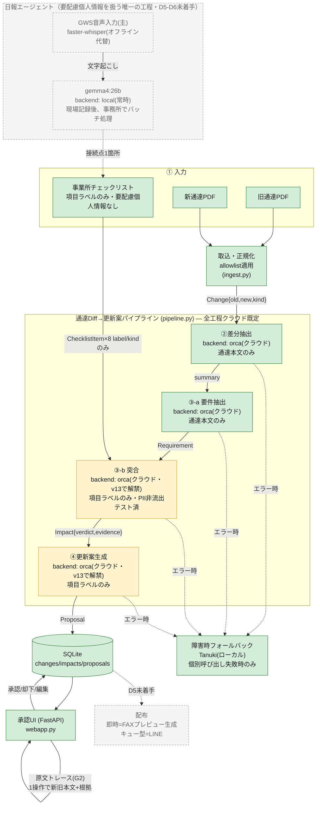

# MOEGI 全体像・現在地（2026-08-11時点）

> **このファイルは design.md（詳細仕様・唯一の真実）を可視化した要約。**
> 詳細な設計判断・実測値・却下案の理由は必ず [design.md](./design.md) と [ledger.md](./ledger.md) を参照すること。
> このファイルはコード変更のたびに更新する保証がない「今のスナップショット」なので、
> 数値・状態が古くなっていたら design.md / ledger.md / state.json を正とする。

## パイプライン全体図（v13・ledger N-11反映）

緑＝実装・実機検証済み。黄＝v13で挙動が変わった箇所（③-b/④がローカル固定→クラウド既定）。
グレー点線＝未着手（日報エージェント本体・D5〜D8）。

## 実装進捗（D1〜D8）

| 日 | 内容 | 状態 |
|---|---|---|
| D0 | 規約照会 | ✅ 完了 |
| D1 | PDF取込・allowlist・日報方針決定・性能実測 | ✅ 完了 |
| D2 | パイプライン4工程・LLMアダプタ層 | ✅ 完了 |
| D3 | ゴールドセット作成・G9計測 | ✅ 完了（G9をG9-a/G9-bに分割） |
| N-10 | evidence参照方式への変更（D3後の追加対応） | ✅ 完了 |
| D4 | 承認UI・原文トレース・薄いE2E | ✅ 実装・実機検証済み。**ユーザー確認待ち** |
| N-11 | プライバシー境界の再定義（③-b/④をクラウド解禁） | ✅ 完了（批評2巡・実装済み） |
| D5 | 配布（FAXプレビュー）・日報・オフライン薄通し・**日報エージェント実装＋D1相当ゲート再実測**・**G9再測定** | ⬜ 未着手 |
| D6 | LINEキュー型チャネル・G6周りのUI・**§7台本#6を実ワークフローに合わせて作り直す** | ⬜ 未着手 |
| D7 | オフライン本番通し・精度差実測・Before動画・台本確定 | ⬜ 未着手 |
| D8 | 予備日・通しリハ | ⬜ 未着手 |

## 今、詰まっている点（要ユーザー判断・確認）

### 1. 【最優先】D4承認UIのユーザー確認がまだ
`http://localhost:8420`（プレビューサーバー起動中）で、承認UI・原文トレース・G9-bバッジをドメイン視点で見てもらう必要がある。ここが通らないとD4を完全クローズにできない（state.json `blockedOn.D4-review`）。

### 2. G9-bバッジが「測定中」表示になっている
③-b突合がクラウド既定（claude-sonnet-5）に変わったため、旧実測値（single-local 33.3%）はもう現在の既定を表さない。承認UIは古い数値を出さず「新既定での再測定待ち」と表示するよう変更済み。**新既定での実測はD5の課題**（design.md §10）。

### 3. 日報エージェントが未実装
gemma4:26bを使う予定だが、実装時に**必ず`reasoning_effort:"none"`等の設定が要る**（さもないと出力がreasoningトークンに全消費され空になる。opus批評C-11で実測確認済み）。単独常駐でのメモリ・速度実測もまだ（D5）。

### 4. §7デモ台本#6の作り直しが未着手
「日報を一言喋ってみてください」の即時構造化という台本は、実際のワークフロー（現場録音→事務所バッチ処理）と一致しない。D6で作り直す予定だが内容は未着手。

### 5. N-8: 突合の過剰検出（未解決）
ローカル8Bモデルでの誤検出だったが、③-bがクラウド（claude-sonnet-5）に変わったことで状況が変化している可能性がある。**再計測が必要**（上記2と合わせてD5で）。

### 6. N-4: 説明資料の記述矛盾（放置されたまま）
厚労省説明資料 p.23 の開始・終了時刻の記載が「明確化」か「義務化」か、2つの調査で食い違っている。原文目視確認が未着手のまま。

### 7. R-56: ASRモデルサイズ未確定
実音声での再測定が**D5に持ち越し**のまま未実施。GWS音声入力が主になったため優先度は下がった可能性がある。

### 8. R-64: `orcarouter/auto` 未疎通
名前空間付き指定（`orcarouter/auto`）なら通る見込みだが、疎通確認が未実施。

## 参照

- 詳細仕様: [design.md](./design.md)
- 決定履歴・却下案の理由: [ledger.md](./ledger.md)
- 機械可読な現在状態: [state.json](./state.json)
- N-11批評原文: [reviews/round-3-opus.md](./reviews/round-3-opus.md) / [reviews/round-3-sonnet.md](./reviews/round-3-sonnet.md)
