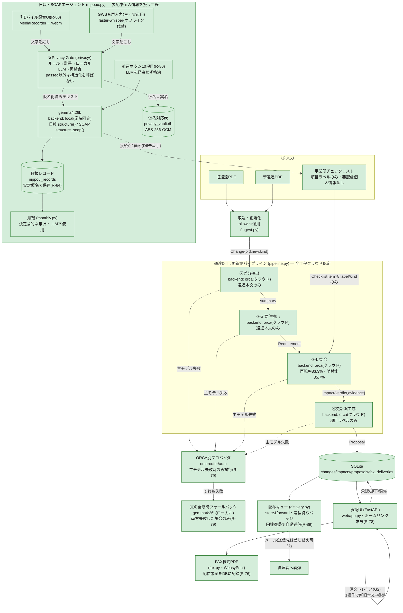

# MOEGI 全体像・現在地（2026-08-12時点）

> **このファイルは design.md（詳細仕様・唯一の真実）を可視化した要約。**
> 詳細な設計判断・実測値・却下案の理由は必ず [design.md](./design.md) と [ledger.md](./ledger.md) を参照すること。
> このファイルはコード変更のたびに更新する保証がない「今のスナップショット」なので、
> 数値・状態が古くなっていたら design.md / ledger.md / state.json を正とする。

## パイプライン全体図（v14・R-79/R-80反映）

緑＝実装・実機検証済み。

## 実装進捗（D1〜D8）

| 日 | 内容 | 状態 |
|---|---|---|
| D0 | 規約照会 | ✅ 完了 |
| D1 | PDF取込・allowlist・日報方針決定・性能実測 | ✅ 完了 |
| D2 | パイプライン4工程・LLMアダプタ層 | ✅ 完了 |
| D3 | ゴールドセット作成・G9計測 | ✅ 完了（G9をG9-a/G9-bに分割） |
| N-10 | evidence参照方式への変更（D3後の追加対応） | ✅ 完了 |
| D4 | 承認UI・原文トレース・薄いE2E | ✅ 完了・ユーザー確認済み（2026-08-11） |
| N-11 | プライバシー境界の再定義（③-b/④をクラウド解禁） | ✅ 完了（批評2巡・実装済み） |
| D5 | 配布（FAXプレビュー）・日報エージェント実装・オフライン薄通し・D1相当ゲート再実測・G9再測定 | ✅ 完了（2026-08-11） |
| D5フォローアップ | G9バッジ削除(R-75)・FAX配信履歴(R-76)・UX修正2件(R-78)・ORCA3段フォールバック(R-79)・モバイル日報UI(R-80) | ✅ **完了（2026-08-12・ユーザーレビュー反映）** |
| D5フォローアップ2 | N-8対策(a)(b)実装採用・オーケストレーションLLM実験実装（/design-loop・批評round-4） | ✅ **完了（2026-08-12深夜・ユーザー就寝中に自律実施）** |
| セキュリティ層 | 仮名化・Privacy Gate（ルール／辞書／ローカルLLM／再検査／fail-closed／仮名対応表の暗号化保管／ログサニタイザー／監査記録）＋ SOAP構造化の追加 | ✅ **完了（2026-08-12）**。仕様は [privacy.md](./privacy.md) |
| 月報 | 日報の永続化（安定仮名で保存）＋ 月報の決定論的な集計（LLM不使用）。R-15「月報はスコープ外」を条件付きで撤回 | ✅ **完了（2026-08-12）**。ledger R-84/R-85・[privacy.md §6-b](./privacy.md) |
| D6 | ✅Before/After比較画面・✅項目の不変ID（R-88）・✅キュー型チャネル（R-89・メール）・✅§7台本の作り直し（script-v2.md・要レビュー）／残: 実機スマホでの録音UI確認 | 🔶 ほぼ完了 |
| D7 | オフライン本番通し・精度差実測・Before動画・台本確定 | ⬜ 未着手 |
| D8 | 予備日・通しリハ | ⬜ 未着手 |

## 主な実測値（D5〜D5フォローアップ2）

- **G9-b（全工程クラウド既定・N-8対策後）**: 再現率 **83.3%**、誤検出率 **9.5%**（N-8対策(a)採用後。対策前は40.5%だった。UI表示はせず、ピッチで開示する運用・R-75）
- **日報エージェント速度**（gemma4:26b・`reasoning_effort="none"`設定込み）: `structure()` コールド **17.8秒**／ウォーム **3.4秒**
- **ORCAのマルチプロバイダ疎通実測（R-79）**: `orcarouter/auto`→qwen3.7-plus解決・5.2秒、`google/gemini-3.6-flash`→4.0秒、いずれも正常応答。旧R-64「未疎通」を解消
- **3段フォールバックの実機動作（R-79）**: 主モデルに存在しないモデル名を指定→自動で`orcarouter/auto`へ切替、6.6秒で正常応答
- **オフライン完走**: ORCA・別プロバイダとも到達不能な場合のみローカル（gemma4:26b）へ落ち、完走を確認
- **N-8対策の実測比較（2026-08-12深夜、各設定4回計測の平均）**: 変更前66.7%/40.5% → 兄弟項目の可視化のみ（採用）再現率平均83.3%/誤検出率平均13.7% → オーケストレーションLLM追加（不採用）再現率平均**70.9%**（低下）/誤検出率平均11.3%。1回目の実測（83.3%/7.1%）は良い方向に振れたrunだった

## 製品化に向けて必要になるもの（ハッカソン範囲外・今後の展望）

セキュリティ層を実装した結果、「デモとして成立する」ことと「実運用に載せられる」ことの
差がはっきりしたので、ここに残しておく。詳細は [privacy.md](./privacy.md) §10。

1. **患者・家族・職員・施設のマスタ連携** — 現在の仮名化辞書
   （`config/pseudonym_dictionary_sample.toml`）は完全な合成データ。実運用では事業所の
   実マスタ（電子カルテ・人事システム）との同期が必要で、**その同期経路自体が新しい
   外部通信・アクセス制御の検討対象**になる。
2. **認証・認可** — 現在アプリに認証は無い。実名を画面に出す経路を作らないことで最悪ケースは
   避けているが、実運用には**ユーザー認証とロールベースの認可**（仮名対応表の復号権限、
   Privacy Gateのモード変更権限、監査記録の閲覧権限）が必須。
3. **本文中の仮名の横断利用** — 月報の集計は安定仮名（利用者コード由来・R-84）で解決したが、
   **日報の本文に出てくる `PATIENT_001` は1リクエスト内でしか一貫しない**。本文どうしを
   横断して読む用途にはまだ使えない（privacy.md §10-8）。

## 今、詰まっている点（要ユーザー判断・確認）

### 1. （解決済み）チェックリスト項目の識別子設計
批評round-4で判明した「識別子が可変なラベル文字列」問題は、**2026-08-12に不変IDを導入して解決**
（ledger R-88）。既存の `sitedoc_item_id`（ラベル・表示用）は残したまま `sitedoc_item_key`
（不変ID）を追加する方式にしたので、`eval/` の計測基盤は1行も変えずに済んでいる。
実害が一番大きかったのは月報の記入率で、ラベルで束ねていると更新案が承認された月に
同じ項目が2行へ割れていた。

### 2. §7デモ台本#6の作り直し（ドラフト済み・要レビュー）
実ワークフローに合わせたドラフトをdesign.mdに用意した（🔧マーク）。演出・審査員への操作委任が
適切かのレビューが必要。

### 3. N-4: 説明資料の記述矛盾（原本がリポジトリに無く調査不能）
厚労省説明資料 p.23 の開始・終了時刻の記載が「明確化」か「義務化」か、2つの調査で食い違っている。原文PDFがリポジトリに存在しないため、原本の所在確認から必要。

### 4. R-56: ASRモデルサイズ未確定
実音声での再測定はfaster-whisper smallで一度実施（4.6秒・妥当な書き起こし）したが、モデルサイズ比較は未実施。GWS音声入力が主になったため優先度は下がった可能性がある。

### 5. モバイル日報UIの実機確認（R-80）
録音UI・処置ボタンは実音声ファイルのアップロード経路のみ確認済み。実機スマホ・タブレットでのマイク許可フロー・タッチ操作は未確認（ヘッドレスブラウザでは検証不可）。

### 6. （解決済み）キュー型配布
**2026-08-13に実装済み**（ledger R-89）。送信先はLINE→**メール**に変更した——G8の要件
（キューに積まれる／復帰で自動的に流れる／手動再送しない）は送信先に依存しないため、
外部連携の承認が要らない方を採った。送信先は差し替え可能。
Before/After比較画面も **2026-08-12に実装済み**（`/runs/{run_id}/before-after`）。

### 7. （解決済み）オーケストレーションLLMの本番採用判断
4回ずつの追加計測の結果、誤検出率のわずかな改善と引き換えに再現率が平均で悪化していると
判明したため**不採用と結論**。実験フラグ（`orchestrate`）として実装だけ残す。48セル・
「要更新」正解6件という規模の限界が判明したため、ゴールドセット拡張（方法2）を今後検討するかは
別途判断が必要（design.md §6.7参照）。

## 参照

- 詳細仕様: [design.md](./design.md)
- 仮名化・Privacy Gate（セキュリティ層）: [privacy.md](./privacy.md)
- 決定履歴・却下案の理由: [ledger.md](./ledger.md)
- 機械可読な現在状態: [state.json](./state.json)
- N-11批評原文: [reviews/round-3-opus.md](./reviews/round-3-opus.md) / [reviews/round-3-sonnet.md](./reviews/round-3-sonnet.md)
