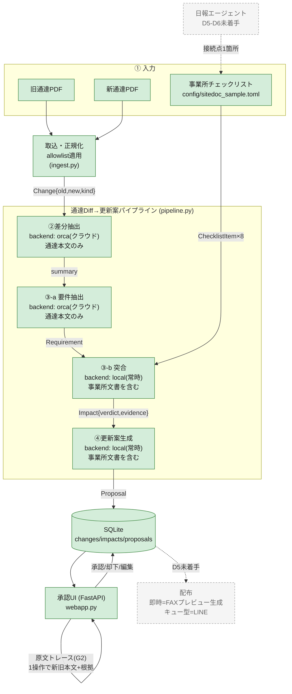

# MOEGI 全体像・現在地（2026-08-10時点）

> **このファイルは design.md（詳細仕様・唯一の真実）を可視化した要約。**
> 詳細な設計判断・実測値・却下案の理由は必ず [design.md](./design.md) と [ledger.md](./ledger.md) を参照すること。
> このファイルはコード変更のたびに更新する保証がない「今のスナップショット」なので、
> 数値・状態が古くなっていたら design.md / ledger.md / state.json を正とする。

## パイプライン全体図

緑＝実装・実機検証済み（D1〜D4）。グレー点線＝未着手（D5〜D8）。

## 実装進捗（D1〜D8）

| 日 | 内容 | 状態 |
|---|---|---|
| D0 | 規約照会 | ✅ 完了 |
| D1 | PDF取込・allowlist・日報方針決定・性能実測 | ✅ 完了 |
| D2 | パイプライン4工程・LLMアダプタ層 | ✅ 完了 |
| D3 | ゴールドセット作成・G9計測 | ✅ 完了（G9をG9-a/G9-bに分割） |
| N-10 | evidence参照方式への変更（D3後の追加対応） | ✅ 完了 |
| D4 | 承認UI・原文トレース・薄いE2E | ✅ 実装・実機検証済み。**ユーザー確認待ち** |
| D5 | 配布（FAXプレビュー）・日報・オフライン薄通し | ⬜ 未着手 |
| D6 | LINEキュー型チャネル・G6周りのUI | ⬜ 未着手 |
| D7 | オフライン本番通し・精度差実測・Before動画・台本確定 | ⬜ 未着手 |
| D8 | 予備日・通しリハ | ⬜ 未着手 |

## 今、詰まっている点（要ユーザー判断・確認）

### 1. 【最優先】D4承認UIのユーザー確認がまだ
`http://localhost:8420`（プレビューサーバー起動中）で、承認UI・原文トレース・G9-bバッジをドメイン視点で見てもらう必要がある。ここが通らないとD4を完全クローズにできない（state.json `blockedOn.D4-review`）。

### 2. N-8: 突合の過剰検出（未解決）
ローカル8Bモデルが無関係な既存項目まで「要更新」と誤検出する（`--label c` で6項目が誤って要更新に）。D4のゴールドセット評価で誤検出率として計測・改善する方針だったが、**まだ実施していない**。N-10（evidence参照方式）で一部改善したが、他ラベルに新規の誤検出も生まれ、モードによってはむしろ悪化した（design.md §3・ledger N-8/N-10参照）。

### 3. N-4: 説明資料の記述矛盾（放置されたまま）
厚労省説明資料 p.23 の開始・終了時刻の記載が「明確化」か「義務化」か、2つの調査で食い違っている。ledger上は「D1タスク」として原文目視確認を予定していたが、**D1完了の記録にこの確認が含まれておらず、未着手のまま**。ピッチでの言い方（想定問答§13）に関わる。

### 4. R-56: ASRモデルサイズ未確定
日本語専門用語の誤認識はASRではなくテスト音声（macOSの`say`の誤読）が原因と判明済みだが、実音声での再測定が**D5に持ち越し**のまま未実施。

### 5. R-64: `orcarouter/auto` 未疎通
名前空間付き指定（`orcarouter/auto`）なら通る見込みだが、ORCA接続可能なセッションでの疎通確認が未実施。

## 参照

- 詳細仕様: [design.md](./design.md)
- 決定履歴・却下案の理由: [ledger.md](./ledger.md)
- 機械可読な現在状態: [state.json](./state.json)
