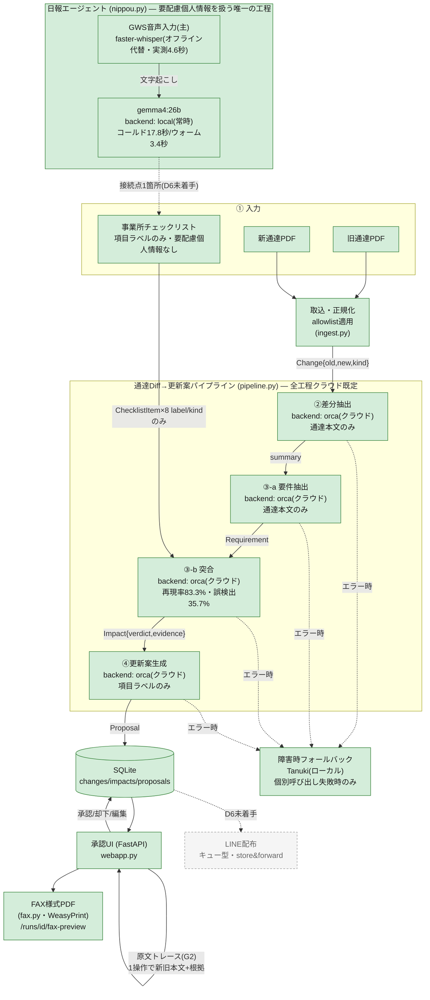

# MOEGI 全体像・現在地（2026-08-11時点）

> **このファイルは design.md（詳細仕様・唯一の真実）を可視化した要約。**
> 詳細な設計判断・実測値・却下案の理由は必ず [design.md](./design.md) と [ledger.md](./ledger.md) を参照すること。
> このファイルはコード変更のたびに更新する保証がない「今のスナップショット」なので、
> 数値・状態が古くなっていたら design.md / ledger.md / state.json を正とする。

## パイプライン全体図（v13・D5実装反映）

緑＝実装・実機検証済み（D1〜D5）。グレー点線＝未着手（LINEキュー型配布・§7台本作り直し＝D6以降）。

## 実装進捗（D1〜D8）

| 日 | 内容 | 状態 |
|---|---|---|
| D0 | 規約照会 | ✅ 完了 |
| D1 | PDF取込・allowlist・日報方針決定・性能実測 | ✅ 完了 |
| D2 | パイプライン4工程・LLMアダプタ層 | ✅ 完了 |
| D3 | ゴールドセット作成・G9計測 | ✅ 完了（G9をG9-a/G9-bに分割） |
| N-10 | evidence参照方式への変更（D3後の追加対応） | ✅ 完了 |
| D4 | 承認UI・原文トレース・薄いE2E | ✅ 完了・**ユーザー確認済み（2026-08-11）** |
| N-11 | プライバシー境界の再定義（③-b/④をクラウド解禁） | ✅ 完了（批評2巡・実装済み） |
| D5 | 配布（FAXプレビュー）・日報エージェント実装・オフライン薄通し・D1相当ゲート再実測・G9再測定 | ✅ **完了（2026-08-11・ユーザー包括承認で無停止実施）** |
| D6 | LINEキュー型チャネル・G6周りのUI・**§7台本#6を実ワークフローに合わせて作り直す** | ⬜ 未着手 |
| D7 | オフライン本番通し・精度差実測・Before動画・台本確定 | ⬜ 未着手 |
| D8 | 予備日・通しリハ | ⬜ 未着手 |

## D5の主な実測値

- **G9-b（新既定・全工程クラウド）**: 再現率 **83.3%**（旧local-Tanuki比0.0%→83.3%）、誤検出率 **35.7%**（旧26.2%から上昇）
- **日報エージェント速度**（gemma4:26b・`reasoning_effort="none"`設定込み）: `structure()` コールド **17.8秒**／ウォーム **3.4秒**。opus批評C-11（reasoningモデル問題）が実機で決着——R-70の「70秒」はほぼ設定漏れが原因だった
- **メモリ**: gemma4:26b単独常駐でスワップ+6.1GB（8.2GB→14.35GB）。24GBに余裕はないが動作
- **オフライン完走**: ORCA不通時、全工程が自動的にローカルへフォールバックし完走を確認（約5分・遅いが落ちない）

## 今、詰まっている点（要ユーザー判断・確認）

### 1. N-8: 突合の過剰検出（悪化傾向が数値化・未解決）
③-bがクラウド（claude-sonnet-5）になり再現率は大幅改善したが、誤検出率も26.2%→35.7%に上昇した。D6〜D7で対処を検討する必要がある。

### 2. §7デモ台本#6の作り直しが未着手
「日報を一言喋ってみてください」の即時構造化という台本は、実際のワークフロー（現場録音→事務所バッチ処理）と一致しない。D6で作り直す予定だが内容は未着手。

### 3. N-4: 説明資料の記述矛盾（放置されたまま）
厚労省説明資料 p.23 の開始・終了時刻の記載が「明確化」か「義務化」か、2つの調査で食い違っている。原文目視確認が未着手のまま。

### 4. R-56: ASRモデルサイズ未確定
実音声での再測定はfaster-whisper smallで一度実施（4.6秒・妥当な書き起こし）したが、モデルサイズ比較は未実施。GWS音声入力が主になったため優先度は下がった可能性がある。

### 5. R-64: `orcarouter/auto` 未疎通
名前空間付き指定（`orcarouter/auto`）なら通る見込みだが、疎通確認が未実施。

### 6. LINEキュー型配布・G6接続点（D6未着手）
日報エージェントとチェックリストの接続点（1箇所）、LINE store-and-forward、Before/After比較画面はまだ実装されていない。

## 参照

- 詳細仕様: [design.md](./design.md)
- 決定履歴・却下案の理由: [ledger.md](./ledger.md)
- 機械可読な現在状態: [state.json](./state.json)
- N-11批評原文: [reviews/round-3-opus.md](./reviews/round-3-opus.md) / [reviews/round-3-sonnet.md](./reviews/round-3-sonnet.md)
