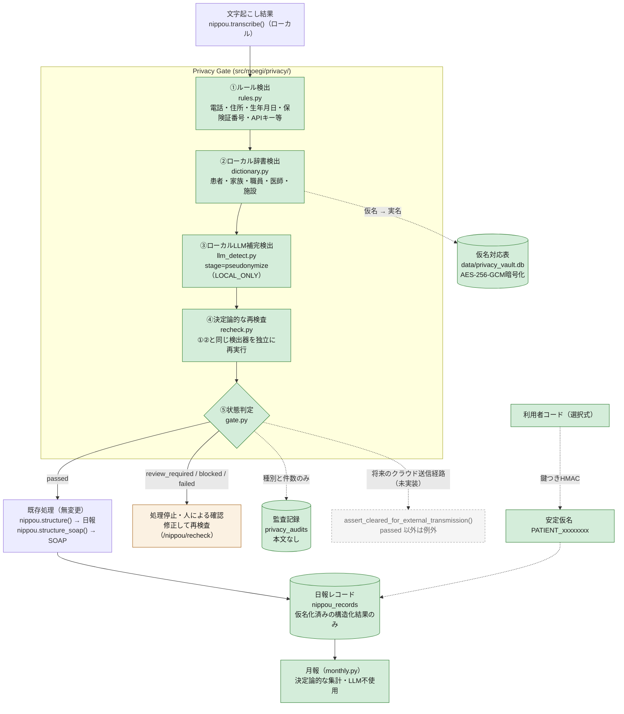

# 仮名化・Privacy Gate（design.md §6.5 の前段に追加した層）

> このファイルは仮名化・安全検査層の仕様。全体の詳細仕様は [design.md](./design.md)、
> 決定履歴は [ledger.md](./ledger.md) を正とする。
>
> ⚠️ **この実装だけで、完全な匿名化や法令・ガイドラインへの準拠を保証したことにはならない。**
> ここで行うのは「直接識別子の仮名化」であり、仮名化後も病状・服薬・処置・家族状況などの
> 要配慮個人情報は残る。コード・UI・資料で「匿名化済み」「個人情報ではない」とは書かないこと。

## 1. データフロー

既存の日報・SOAP構造化処理の**前段**に検査層を挟む。既存の構造化ロジックには手を入れず、
接続は「仮名化済みテキストを渡す」「passed でなければ呼ばない」の2点だけ。



**設計意図**: 仮名化をローカルLLMだけに依存させない。①②は決定論的で、同じ入力からは常に
同じ出力が出る。③はそれだけでは拾えない文脈依存情報の**補完**にすぎず、④の再検査は
③から完全に独立している。「LLMが消したつもりで消せていない」を、LLMを使わずに検知できる。

## 2. Privacy Gate の状態

```typescript
type PrivacyGateStatus = "pending" | "passed" | "review_required" | "blocked" | "failed";
```

| 状態 | 意味 | 既存処理へ進むか（enforce） |
|---|---|---|
| `pending` | まだ検査していない | 進まない |
| `passed` | 検査に合格 | **進む** |
| `review_required` | 個人を特定し得る情報が残っている可能性がある | 進まない（人が確認・修正して再検査） |
| `blocked` | 記録に残してはいけない情報（保険証番号・診察券番号・APIキー・JWT・URL内認証情報） | 進まない |
| `failed` | 検査自体が完了しなかった（対応表の保存失敗・入力不正） | 進まない |

### 段階導入モード

| モード | 挙動 |
|---|---|
| `observe` | 検出・記録のみ。不合格でも既存処理へ進む |
| `shadow` | 「本番なら停止していた」旨を画面表示するが既存処理は継続 |
| `enforce` | `passed` 以外は既存処理を呼ばない（**本番の最終目標。現在の既定**） |

- 変更経路は `config/privacy.toml` と環境変数 `MOEGI_PRIVACY_MODE` の2つだけ。
- **HTTPリクエストからモードを変える経路は実装していない。** `run_gate()` は `mode` 引数を
  受け取らず、`/nippou/structure` `/nippou/recheck` も `mode` を受け付けない
  （tests/test_privacy.py がシグネチャで固定している）。
- **外部送信の判定にはモードの緩和を効かせない。** `cleared_for_external_transmission()` は
  3モードとも `passed` のときだけ True。段階導入は「事業所内の既存処理を止めない」ための
  猶予であって、外部送信を緩める理由にはならない。

## 3. 仮名化ポリシー（policy_version = 2026-08-12.1）

| 情報 | 処理 | 実装 |
|---|---|---|
| 患者氏名 | `PATIENT_001` へ置換 | 辞書 |
| 家族氏名 | 続柄（`長女`・`配偶者`）、無ければ `FAMILY_001` | 辞書 |
| 職員氏名 | `NURSE_001` へ置換 | 辞書 |
| 医師氏名 | `DOCTOR_001` へ置換 | 辞書 |
| 施設・医療機関名 | `FACILITY_001` へ置換 | 辞書 |
| 電話番号 | `[[PHONE]]` | ルール＋辞書 |
| メールアドレス | `[[EMAIL]]` | ルール |
| 郵便番号 | `[[POSTAL_CODE]]` | ルール |
| 詳細住所 | 都道府県レベルへ一般化（`東京都[[ADDRESS]]`） | ルール＋辞書 |
| 生年月日 | 年代へ変換（`(80代)`）。西暦・和暦の両方 | ルール |
| 保険証番号 | **ブロック** | ルール |
| 診察券番号 | **ブロック** | ルール |
| 利用者ID | `[[PATIENT_ID]]` | ルール |
| IPアドレス | `[[IP_ADDRESS]]` | ルール |
| URL内の認証情報 | **ブロック** | ルール |
| APIキー・JWT | **ブロック** | ルール |
| 病名・症状・服薬 | **原則保持**（消さない） | — |
| バイタル・処置 | **原則保持**（消さない） | — |

臨床情報を保持するための具体策:
- 番号系（保険証・診察券・利用者ID）は**ラベル付きでのみ**検出する。裸の数字列を番号扱いすると
  バイタル値や訪問時間を巻き込んで記録が壊れる。
- 電話番号は総桁数（10桁 or 11桁）をコード側で確認してから確定する。`血圧128/78` は電話にならない。
- 都道府県名だけの記述は一般化しない（既に地域レベルのため）。
- 入力と出力の文字数差が `max_removal_ratio`（既定0.5）を超えたら `review_required`。
  ローカルLLMが臨床情報まで削った可能性を検知する。

## 4. ルール・辞書・ローカルLLMの役割分担

| 層 | 得意なもの | 保証 |
|---|---|---|
| ルール（`rules.py`） | 形が決まっている識別子・秘密情報 | 決定論的。同じ入力＝同じ出力 |
| 辞書（`dictionary.py`） | 事業所マスタに載っている固有名・住所・電話 | 決定論的。表記ゆれは `aliases` で吸収 |
| ローカルLLM（`llm_detect.py`） | 文脈依存の固有名（「娘の花子」「向かいの佐々木さん」） | **保証しない**。補完のみ |
| 再検査（`recheck.py`） | ①②の検出器の再実行＋辞書照合 | LLMから独立。ここが最後の砦 |

- **辞書の内容は外部にもローカルLLMにも渡さない。** 照合はすべてコード側の完全一致で行い、
  LLMには「①②で仮名化し終わったテキスト」だけを渡す（テストで固定）。
- 一般名詞との衝突対策: フルネーム・エイリアスは完全一致、姓のみは敬称（さん/様/氏/先生/ちゃん/くん）を
  伴う場合だけ検出する。「自宅の裏の森まで散歩」の「森」は職員名にしない。
- 同姓同名: 同じ表記に複数人が対応する場合、一意に決められないので `review_required`。
- ReDoS対策: 入力長を先に `max_input_chars`（既定20000字）で打ち切る／すべての量化子に上限を
  付ける／量化子をネストさせない／曖昧な判定は正規表現ではなくPythonコード側で確定させる。

## 5. fail-closed になる条件

| 条件 | 状態 |
|---|---|
| 入力が空 | `failed` |
| 入力が `max_input_chars` を超える | `blocked` |
| 文字化け（U+FFFD・制御文字が5%超） | `failed` |
| 辞書の読み込み失敗 | `review_required` |
| 保険証番号・診察券番号・APIキー・JWT・URL内認証情報を検出 | `blocked` |
| 同姓同名など一意に特定できない照合 | `review_required` |
| ローカルLLMのタイムアウト | `review_required` |
| ローカルLLMへの接続失敗 | `review_required` |
| ローカルLLM応答のJSON不正・スキーマ違反 | `review_required` |
| ローカルLLMが `needs_human_review = true` を返した | `review_required` |
| 残存リスクが `max_residual_risk` を超える | `review_required` |
| 入出力の差分が `max_removal_ratio` を超える | `review_required` |
| 再検査で禁止対象が残っていた | `review_required`（秘密情報なら `blocked`） |
| 仮名対応表の保存に失敗（仮名化した箇所があるのに対応表DBを開けない場合を含む。画面は `require_vault=True` で呼ぶ） | `failed` |

`run_gate()` はどの経路でも例外を投げず `GateResult.status` で返す。呼び出し側が例外を
握り潰しても、`cleared_for_downstream()` を通らないかぎり既存処理には進めない。

## 6. 仮名対応表の管理

- **保存先**: `data/privacy_vault.db`（原文DB `data/moegi.db` とは**別ファイル**）。
  同じDBに入れると「更新案を見るためのDB接続」がそのまま対応表への到達経路になる。
- **暗号化**: AES-256-GCM（`cryptography` パッケージ。独自方式は作らない）。
  `request_id` をAAD（追加認証データ）に結び付け、別レコードの暗号文をすり替えても復号できない。
- **鍵**: `MOEGI_VAULT_KEY`（環境変数・base64） > 鍵ファイル `data/.vault_key`（無ければ生成・0600）。
  **ソースコードにもDBにも鍵を書かない。** `data/` は `.gitignore` 済み。
- **保存期間**: `retention_days`（既定90日）。`vault.purge_expired()` で削除。
- **削除**: `vault.delete_mapping(conn, request_id)`。
- **アクセス**: 復号関数 `vault.decrypt_mapping()` は webapp から呼ばない。画面に実名を出す経路を
  作らないことで「権限のない利用者に元の値が見える」状態を構造的に排除している。
  再結合が必要な場合はローカル環境の管理者がCLIから実行する。
- **バックアップ**: DBファイル単位で暗号化されているため、ファイルをコピーしても平文は出ない。
  ただし**鍵ファイルを同じ場所にバックアップすると保護が無効になる**——鍵とDBを別の保管先に置くこと。

## 6-b. 日報レコードと安定仮名（月報のための保存・ledger R-84/R-85）

月報（1ヶ月分の日報の集約）には「同じ人の記録をまとめる鍵」が要る。しかし Privacy Gate が
採番する `PATIENT_001` は1リクエスト内でしか一貫しないため、別に安定した鍵を用意した。

- **利用者コードはUIで選択式**（`config/pseudonym_dictionary_sample.toml` の `code`）。
  処置ボタン（ledger R-77）と同じ「LLMに任せず決定的なUIに倒す」流儀で、
  **LLMに患者の同定をさせない**。
- **安定仮名** = `vault.stable_pseudonym(code)` = `PATIENT_` + HMAC-SHA256(鍵, "PATIENT:"+code) の先頭12桁。
  鍵つきなので、鍵を持たない者はコードから仮名を作れず、仮名からコードも逆算できない
  （利用者コードは桁数が少なく、素のSHA256だと総当たりで逆引きできてしまう）。
  **鍵が変わると過去の日報と結びつかなくなる**ので、鍵ファイルは対応表DBと同じ重みで保全すること。

### `nippou_records` に保存するもの／しないもの

| 保存する | 保存しない |
|---|---|
| 安定仮名（`subject_pseudonym`） | **利用者コードそのもの** |
| 訪問日・Privacy Gate状態・ポリシーバージョン | **文字起こし原文**（列が存在しない） |
| 仮名化済みの構造化結果（items / evaluation / SOAP） | **音声データ** |
| 処置内容（人が選んだ確定値） | **仮名対応表**（別DB） |

- **Privacy Gate が不合格なら、構造化も保存も行わない**（`_structure_and_render` の同じ分岐で止まる）。
- 利用者コードが選ばれていない場合は保存しない。「誰の記録か分からない日報」を入れると
  月報の集計が静かに狂うため、保存しなかったことを画面に出す。
- 月報画面（`/monthly`）は **GETではなくPOST** で条件を受ける。利用者コードをURLのクエリ文字列に
  載せると、ブラウザ履歴・アクセスログ・Referer に識別子が残るため。

### 月報がLLMを使わない理由

1. 月報は加算のエビデンスにも使われ得るため、**数字が実行のたびに揺れてはいけない**
2. LLM要約は要配慮個人情報の**集積**を1回のプロンプトに載せることになり、
   ローカル固定でも露出面が増える

集計内容は訪問回数・訪問日数・処置別回数・チェックリスト項目の記入率・評価の記入状況・
バイタルの推移。バイタルは**バイタル項目とSOAPのO欄からのみ**抽出し（訪問時刻
「10:30/11:00」を血圧と誤読しないため）、収縮期 > 拡張期 の妥当性も確認する。
**読み取れなかった訪問は0として混ぜず件数として残す**——月報の数字が実態より
良くも悪くも見えるのを避けるため。

## 7. ログへ出さない情報

**出さない**: 文字起こし原文／仮名化済み文章全文／日報・SOAP全文／実名／電話番号／詳細住所／
音声データ／仮名対応表／完全なLLMプロンプト／完全なLLMレスポンス／APIキー・認証情報。

**記録してよい**（`privacy.ALLOWED_AUDIT_FIELDS` の許可リスト）: request_id／拠点ID／実行日時／
Privacy Gate状態／検出した情報種別と件数／ポリシーバージョン／人の確認が必要か／残存リスク／
処理時間／エラーコード／使用したローカルモデル名／構造化処理へ進んだか／外部送信の有無。

二重の守り:
1. **出さない** — `GateResult` は原文を保持しない。監査テーブル `privacy_audits` には
   本文列が無く、`detected_counts` は「種別 → 件数」だけ。`store.save_privacy_audit()` は
   キーワード引数を明示列挙しており、`**kwargs` で本文を渡す余地がない。
2. **漏れても落とす** — `privacy.install_log_sanitizer()` が root / uvicorn / uvicorn.access /
   uvicorn.error / fastapi / httpx / httpcore のロガーへフィルタを差し込み、logging を通る
   全レコードのメッセージ・引数・**例外メッセージ**をサニタイズし、400字で打ち切る。
   例外は文字列化してから `exc_info` を落とすので、トレースバック経由でも本文は出ない。

## 8. 外部通信先の調査結果（2026-08-12時点）

| 宛先 | 内容 | 判定 |
|---|---|---|
| `api.orcarouter.ai`（ORCA Router） | 通達本文・チェックリスト項目ラベル（`diff`/`requirement`/`matching`/`draft`） | 患者データを含まない（公開情報＋テンプレート定義） |
| `localhost:11434`（Ollama） | 日報・SOAP構造化（`nippou`）、仮名化補完検出（`pseudonymize`） | ローカル。`LOCAL_ONLY_STAGES` で強制 |
| HuggingFace | faster-whisper の**モデル初回ダウンロードのみ**。音声・文字起こしは送らない | 要記載（オフライン運用時は事前取得が必要） |
| エラートラッキング／アクセス解析／CDN／外部フォント／クラッシュレポート／テレメトリー／自動アップデート／外部ストレージ | **なし**（`design.md §14`「CDN依存ゼロ」方針が守られている） | ✅ |

- 文字起こし原文・音声・日報・SOAP・仮名対応表が外部送信される経路は**現時点で存在しない**。
- `nippou` と `pseudonymize` は `llm.LOCAL_ONLY_STAGES` に入っており、`models.toml` で
  `backend = "orca"` を指定すると**起動時に `ConfigError` で拒否**される。
- 今回の実装で OrcaRouter や新しいクラウドLLMを本番処理へ追加していない。

## 8-b. 実際の外部送信経路: 配布のキュー型チャネル（ledger R-89）

2026-08-13 に、**この設計で初めての意図的な外部送信**が入った（承認済み更新案のメール配布）。
外部送信の境界がどう効いているかを記録しておく。

| 項目 | 内容 |
|---|---|
| 送るもの | **承認済み更新案のみ**（チェックリスト項目のラベル、更新後の文言、条文パス） |
| 送らないもの | 文字起こし原文／日報／SOAP／仮名対応表／通達原文の引用 |
| 判断根拠 | ledger N-11 のプライバシー境界。チェックリストは項目ラベルのテンプレート定義であり、要配慮個人情報を含まない |
| 止め方 | `delivery.enqueue()` が件名と本文を `rules.detect()` にかけ、識別子・秘密情報が1つでも見つかったら**キューに入れること自体を拒否**する |

**「送信直前に止める」ではなく「キューに入る前に止める」**設計にした。こうすると
キューの中身は常に送ってよいものだけになり、送信側は内容を検査しなくてよくなる。
拒否時の例外メッセージには検出した**値ではなく種別だけ**を載せる。

なお、日報・SOAPの経路は引き続き外部へ出ない。この配布経路と日報の経路は
1本も繋がっていない（`delivery.py` は `nippou` も `monthly` も import しない）。

## 9. 将来クラウドLLMを追加する場合の条件

`privacy.assert_cleared_for_external_transmission(result)` を**外部送信の直前に必ず呼ぶ**。
`passed` 以外は `ExternalTransmissionBlocked` を投げる。現時点で本番の呼び出し箇所は無く、
境界の定義とテストだけが存在する。

クラウド経路を実際に追加する場合の最低条件:
1. Privacy Gate が `passed` であること（`observe`/`shadow` の緩和は効かない）
2. 仮名対応表を送らないこと（`GateResult` に対応表は載っていない）
3. 送信先のデータ保持ポリシー・所在地を確認すること
4. 送信の有無を監査記録（`external_transmission`）に残すこと
5. OrcaRouter Guardrails は**その経路における二重目の防御**であり、
   本ドキュメントのローカル仮名化を代替しない。
   **【2026-08-15 実装・ledger R-91】** クライアント側の対応とポリシー定義を実装した:
   - `llm.py`: ゲートウェイの遮断（HTTP 400 `guardrail_blocked`）を通常エラーと区別し、
     skip-retry（cloud_fallback_model を試さない）でローカルへフォールバック。
     circuit breaker には加算しない（ゲートウェイ自体は健全に応答しているため）。
     発火は `cost_records.guardrail_blocked` に監査として残る
   - `scripts/setup_orca_guardrail.py`: ポリシー `moegi-cloud-boundary` の定義
     （日本向けカスタム検出器6種はRE2安全・マスク表記はMOEGIの型付きタグと同一）と
     冪等プロビジョニング・サンドボックス検証
   - **未完了の1操作**: ORCA管理APIはコンソールのアクセストークンが必要
     （リレー用 `sk-orca-` キーでは認証不可・実測）。ガードレールの作成と
     APIキーへの紐づけはコンソールでの手動操作（約5分・スクリプトが手順を印字する）

## 10. 残存リスク（未解決）

1. **仮名化後も要配慮個人情報が残る。** 病名・症状・服薬・処置・家族構成・生活状況は保持する
   仕様なので、記録そのものの取り扱いは従来どおり厳重に。
2. **属性の組み合わせによる再特定。** 利用者が少ない事業所では「80代・独居・胃瘻」だけで
   個人が絞れる。仮名化ではこれを消せない。
3. **辞書に無い固有名はローカルLLM頼み。** LLMの見落としは `review_required` で人へ回るが、
   LLMが「検出なし・residual_risk=low」と誤答した場合は `passed` になり得る。
   再検査はルールと辞書に載る対象しか捕まえられない。
4. **認証・認可が無い。** 現状は誰でも `/nippou` にアクセスできる。
   実名を画面に出す経路を作らないことで最悪ケースは避けているが、**製品化時にはユーザー認証と
   ロールベースの認可（対応表の復号権限を含む）が必須**。
5. **患者・職員・施設マスタが無い。** 現在の辞書は合成データ。
   **製品化時には事業所の実マスタ（電子カルテ・人事システム）との同期が必要**で、
   その同期経路自体が新しい外部通信・アクセス制御の検討対象になる。
6. **音声ファイルの一時保存。** アップロードされた音声は `tempfile` に書かれ、処理後に削除するが、
   処理中はディスク上に平文で存在する。
7. **鍵ファイルの保護はOSのファイルパーミッションのみ。** ディスク暗号化（FileVault等）と
   組み合わせる前提。HSM・キーチェーン連携は未実装。
8. **本文中の仮名の一貫性は1リクエスト内のみ。** 同じ患者でも訪問ごとに `PATIENT_001` が
   別人を指し得る。月報の集計は §6-b の**安定仮名**（利用者コード由来）で行うので影響しないが、
   **日報の本文どうしを横断して読む用途には使えない**。
9. **日報レコードそのものは要配慮個人情報。** 仮名化済みでも看護記録の本体（病状・服薬・処置）は
   残る。DBファイルの保護はディスク暗号化とファイルパーミッションに依存しており、
   認証・認可が無い現状ではアプリに到達できる者は月報を閲覧できる（上記 4 と同じ論点）。

## 11. 関連ファイル

| ファイル | 役割 |
|---|---|
| `src/moegi/privacy/config.py` | 設定読み込み・モードの変更経路の限定 |
| `src/moegi/privacy/rules.py` | ルールベース検出・置換・重なり解決 |
| `src/moegi/privacy/dictionary.py` | ローカル辞書の照合・仮名の採番 |
| `src/moegi/privacy/llm_detect.py` | ローカルLLM補完検出・JSON Schema検証 |
| `src/moegi/privacy/recheck.py` | 決定論的な再検査 |
| `src/moegi/privacy/vault.py` | 仮名対応表の暗号化保管・削除・保存期間 |
| `src/moegi/privacy/gate.py` | 状態機械・fail-closed・外部送信境界 |
| `src/moegi/privacy/logsafe.py` | ログサニタイザー・監査フィールド許可リスト |
| `config/privacy.toml` | ポリシーバージョン・モード・閾値 |
| `config/pseudonym_dictionary_sample.toml` | 合成辞書（実運用では差し替え）。利用者コードもここ |
| `src/moegi/monthly.py` | 月報の決定論的な集計（LLM不使用・ledger R-84） |
| `tests/test_privacy.py` | 仮名化・Privacy Gate のテスト（合成データのみ） |
| `tests/test_monthly.py` | 日報の永続化・安定仮名・月報のテスト（合成データのみ） |
